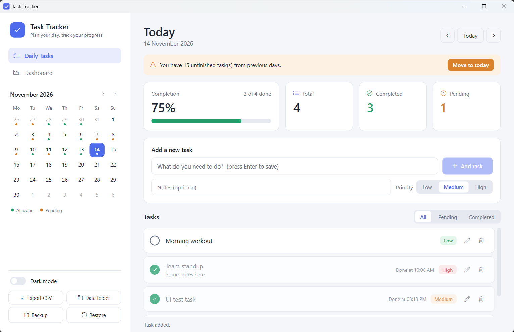
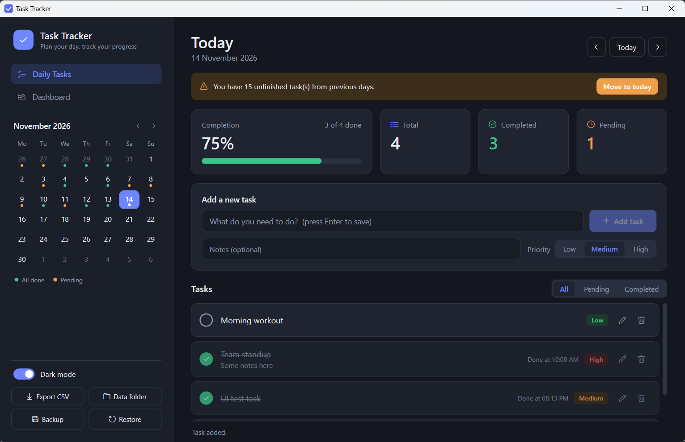
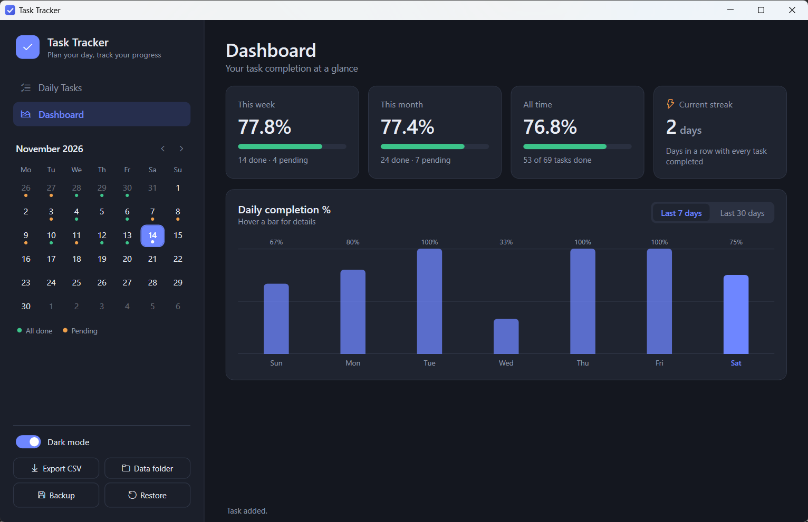

<div align="center">


# Task Tracker

**A clean, offline daily task tracker for Windows.**
Plan each day, tick tasks off, and see your completion percentage over time.

[](LICENSE)


[](CONTRIBUTING.md)
[](https://github.com/Darkethic06/TaskTracker/releases/latest)
[](https://github.com/Darkethic06/TaskTracker/releases)

### [⬇️ Download for Windows](https://github.com/Darkethic06/TaskTracker/releases/latest)

[Features](#-features) · [Download](#-download--install) · [Build from source](#-build-from-source) · [Contributing](#-contributing) · [Roadmap](#-roadmap)

</div>

---

## 📸 Screenshots

| Daily tasks (light) | Daily tasks (dark) |
|---|---|
|  |  |

**Dashboard**



---

## ✨ Features

### 📅 Daily planning
- A **month calendar** in the sidebar. Coloured dots mark days that are fully done 🟢 or still have pending tasks 🟠.
- Add, edit and delete tasks, each with optional **notes** and a **Low / Medium / High** priority.
- Mark a task done with one click. The app records the time you finished it.
- Filter tasks by **All / Pending / Completed**.
- Move between days with the **previous / Today / next** buttons.

### 📊 Progress tracking
- For each day: **total, completed and pending** counts, plus a **completion % bar**.
- A **Dashboard** with:
  - completion % for this week, this month and all time
  - a 🔥 **streak**: days in a row where every task was finished
  - a **bar chart** of daily completion for the last 7 or 30 days

### ⏰ Overdue tasks
- A banner warns you when unfinished tasks are left on past days, and **Move to today** carries them forward in one click.

### 🔒 Your data stays on your PC
- **100% offline.** No account, no cloud, no telemetry.
- Everything is stored in a single local **SQLite** file.
- **Export to CSV** (opens in Excel), plus one-click **backup and restore**.

### 🎨 Polished UI
- Modern WPF interface with **light and dark themes**. Your theme choice is remembered.
- Keyboard friendly: **Enter** saves a task, **Esc** cancels an edit.

---

## 📥 Download & Install

1. Go to the [**latest release**](https://github.com/Darkethic06/TaskTracker/releases/latest).
2. Under **Assets**, download `TaskTrackerSetup-x.y.z.exe`.
   (Direct link for v1.0.0: [TaskTrackerSetup-1.0.0.exe](https://github.com/Darkethic06/TaskTracker/releases/download/v1.0.0/TaskTrackerSetup-1.0.0.exe))
3. Run it. No admin rights are needed for a per-user install.

> The installer is **self-contained**, so you don't need to install .NET separately.
>
> Windows SmartScreen may warn you because the installer isn't code-signed. Click **More info → Run anyway**.

### Where is my data?

| Item | Location |
|---|---|
| Tasks database | `%AppData%\TaskTracker\tasks.db` |
| Settings (theme) | `%AppData%\TaskTracker\settings.json` |
| Error log (if any) | `%AppData%\TaskTracker\error.log` |

Click **Data folder** in the app to open this location.
Uninstalling **does not delete your tasks**, so upgrading or reinstalling is safe.

---

## 🛠 Tech Stack

| Layer | Technology |
|---|---|
| Language | C# 12 |
| UI | WPF (.NET 8) |
| Architecture | MVVM, using [CommunityToolkit.Mvvm](https://github.com/CommunityToolkit/dotnet) |
| Database | SQLite via [Entity Framework Core 8](https://learn.microsoft.com/ef/core/) |
| Installer | [Inno Setup 6](https://jrsoftware.org/isinfo.php) |

---

## 🧑‍💻 Build from source

### Prerequisites
- Windows 10 or 11
- [.NET 8 SDK](https://dotnet.microsoft.com/download/dotnet/8.0) (`winget install Microsoft.DotNet.SDK.8`)
- *(Only for building the installer)* [Inno Setup 6](https://jrsoftware.org/isdl.php) (`winget install JRSoftware.InnoSetup`)
- Any editor: Visual Studio 2022, VS Code with C# Dev Kit, or JetBrains Rider

### Run the app
```powershell
git clone https://github.com/Darkethic06/TaskTracker.git
cd TaskTracker/TaskTracker.App
dotnet run
```

### Use a separate test database
Set `TASKTRACKER_DATA` so development runs don't touch your real tasks:
```powershell
$env:TASKTRACKER_DATA = "C:\temp\tasktracker-dev"
dotnet run
```

### Build the installer
```powershell
.\build-installer.ps1
```
Output: `installer\output\TaskTrackerSetup-<version>.exe`

---

## 📁 Project Structure

```
TaskTracker/
├── TaskTracker.App/
│   ├── Models/          # TaskItem entity + TaskPriority enum
│   ├── Data/            # AppDbContext (EF Core + SQLite)
│   ├── Services/        # TaskService (all DB access, stats, backup), SettingsService
│   ├── ViewModels/      # MainViewModel, TaskItemViewModel, CalendarDay, ChartBar
│   ├── Converters/      # XAML value converters
│   ├── Themes/          # Light.xaml, Dark.xaml (colours) + Styles.xaml (controls)
│   ├── Assets/          # App icon
│   └── MainWindow.xaml  # Main UI
├── installer/
│   └── TaskTracker.iss  # Inno Setup script
├── docs/screenshots/
├── build-installer.ps1
├── CONTRIBUTING.md
└── LICENSE
```

### Database schema

```sql
CREATE TABLE Tasks (
    Id          INTEGER PRIMARY KEY AUTOINCREMENT,
    Title       TEXT    NOT NULL,
    Notes       TEXT    NULL,
    TaskDate    TEXT    NOT NULL,   -- yyyy-MM-dd (indexed)
    Priority    INTEGER NOT NULL,   -- 0 Low, 1 Medium, 2 High
    IsCompleted INTEGER NOT NULL,   -- 0 / 1
    CompletedAt TEXT    NULL,
    CreatedAt   TEXT    NOT NULL
);
```

Completion % is always **calculated** from the tasks (completed ÷ total) and never stored, so it can't go out of sync.

---

## 🗺 Roadmap

- [ ] Recurring tasks (e.g. *Gym every Mon / Wed / Fri*)
- [ ] Reminders and Windows notifications
- [ ] Task categories / tags with colours
- [ ] Search across all dates
- [ ] Drag-and-drop reordering
- [ ] Start with Windows / system tray mode
- [ ] Import from CSV
- [ ] Unit test project + GitHub Actions CI
- [ ] Code-signed installer

Want one of these? Open an issue or pick one up. See [Contributing](#-contributing).

---

## 🤝 Contributing

Contributions are welcome: bug reports, feature ideas, UI polish, docs and code.

1. Fork the repo and create a branch: `git checkout -b feature/my-feature`
2. Make your changes and check that the app builds and runs
3. Commit: `git commit -m "Add my feature"`
4. Push and open a **Pull Request**

Please read [CONTRIBUTING.md](CONTRIBUTING.md) for coding guidelines and project conventions.

Found a bug? [Open an issue](https://github.com/Darkethic06/TaskTracker/issues/new) with steps to reproduce, and attach `%AppData%\TaskTracker\error.log` if one exists.

---

## 📄 License

Released under the [MIT License](LICENSE). You're free to use, modify and distribute it.

---

<div align="center">

If this project helps you stay productive, please give it a ⭐ on GitHub!

Made with ❤️ by **Arijit Paul**

</div>
